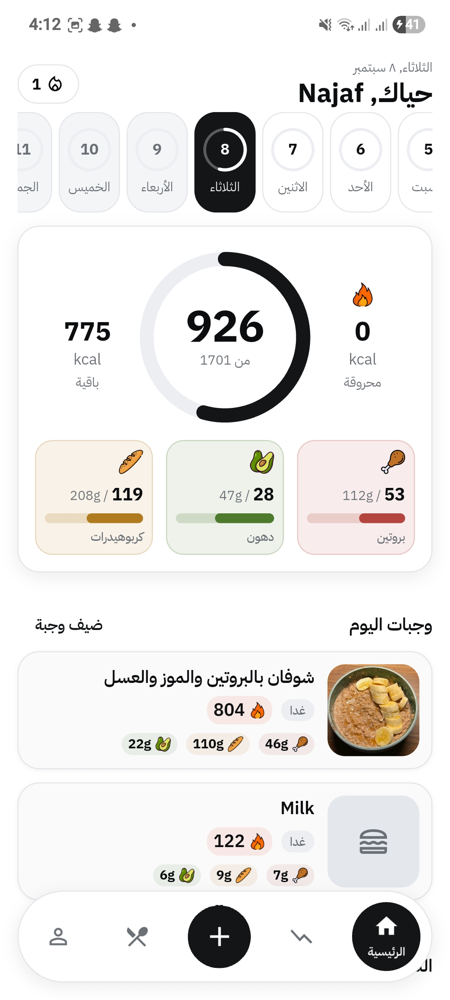
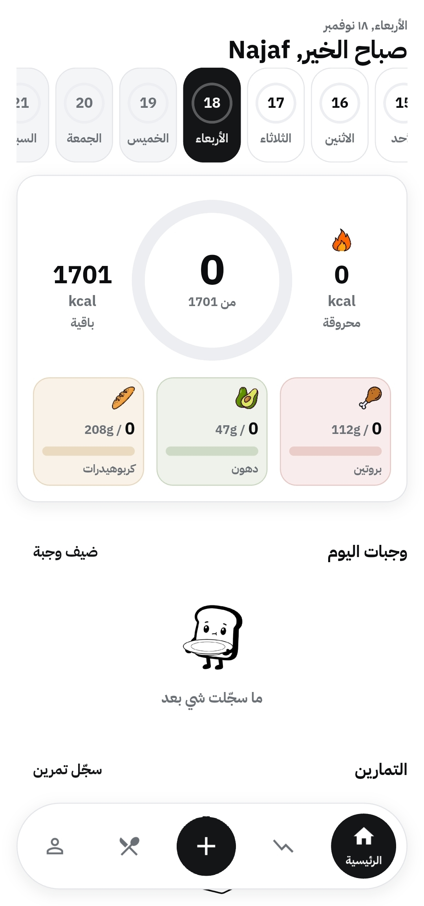
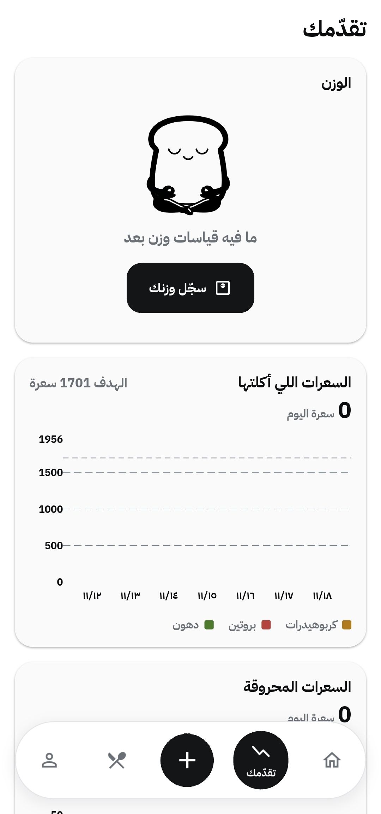
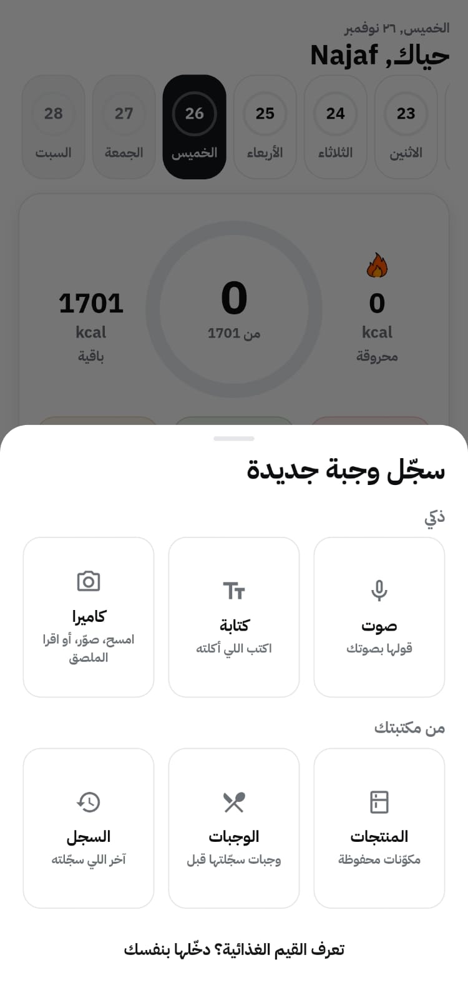

# ScanFit

> AI-powered nutrition tracking app — scan your meal, get instant nutritional breakdowns(calories, carbs, fat, and protein).

**Note:** This repository is a **showcase** for ScanFit. The source code is private; this repo contains only screenshots and a description of the project, the architecture, and the engineering decisions behind it.

---

## Overview

ScanFit is a mobile nutrition-tracking app that lets users log meals by simply scanning or photographing their food. Using AI-powered image recognition, it identifies the food and returns a nutritional breakdown — calories, macros, and more — removing the friction of manual food logging.

The project was built as a flagship portfolio piece, with an architecture designed to mirror the standards of a production-grade mobile application rather than a typical demo app.

---

## Screenshots

<!-- Replace the paths below with your actual screenshot files -->

  
  
  
  

---

## Key Features

- 📷 **AI meal scanning** — point the camera at a meal and get an instant food identification
- 🔢 **Nutritional breakdown** — calories, protein, carbs, and fats calculated automatically
- 📊 **Progress tracking** — daily and historical logging of meals and nutrition goals
- ⚡ **Fast, responsive UI** — built with a clean, modern mobile interface
- ☁️ **Cloud-synced data** — meals and history persist across devices

---

## Tech Stack

**Frontend (Mobile)**
- Flutter + Dart
- BLoC (state management)
- Clean Architecture

**Backend**
- FastAPI (Python)
- PostgreSQL — primary data store
- Redis — caching layer
- Supabase — auth / backend services

**AI**
- Gemini 3.5 Flash (vision model) — food recognition from images

**Infrastructure**
- Railway / Fly.io — deployment and hosting

---

## Architecture Highlights

- Clean Architecture separation between presentation, domain, and data layers for testability and scalability
- BLoC-driven state management for predictable, reactive UI updates
- AI vision pipeline integrated directly into the meal-logging flow for low-friction food scanning
- Iterative UX refinement on the core scanning and logging flows based on usability testing

---

## Why No Code Here?

This repository exists to showcase ScanFit's design, product thinking, and engineering approach without exposing the production source code. For a deeper technical walkthrough, feel free to reach out — I'm happy to discuss the implementation in detail.

---

## Contact

Built by **Najaf** — Software Engineer
<!-- Add your preferred contact links, e.g. LinkedIn, email, portfolio site -->
